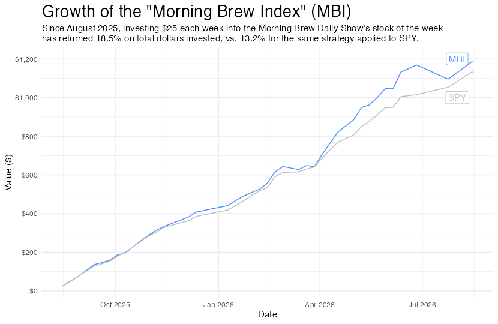

# Morning Brew Index (MBI)

**What if you invested $25 every week in the Morning Brew Daily show's "Stock of the Week"?**

This project tracks that strategy, the *Morning Brew Index*, and compares it against the same dollar-cost-averaging strategy applied to the S&P 500 (SPY).



## Results

| | Invested | Value | Return |
|---|---:|---:|---:|
| **MBI** (stock of the week) | $1,000 | $1,184.89 | **+18.5%** |
| **SPY** (benchmark) | $1,000 | $1,132.38 | +13.2% |

*As of 2026-08-15, the latest date in the market data. Each of the 40 picks gets $25 (fractional shares) on the day it is announced and is held to the present. Figures are price returns from Yahoo Finance closes and ignore dividends, fees and taxes.*

## How it works

1. **Picks** are hand-logged in `data/raw/mbdata.xlsx` (date, stock of the week, dog of the week, tickers).
2. **Prices** for every picked ticker (and SPY) are pulled from Yahoo Finance with `yfinance`, then matched to each pick at 1-week, 1-month, 6-month and 1-year horizons.
3. **Returns** are computed by buying `$25 / price` shares of each pick and valuing the holdings at the latest close.
4. **Weekly comparison** replays the portfolio week by week against the SPY benchmark.
5. **Plot** is rendered with `ggplot2`.

## Project structure

```
MorningBrewViz/
├── assets/
│   └── mbi.png                    # final chart (generated by step 5)
├── data/
│   ├── raw/mbdata.xlsx            # hand-entered picks (source of truth)
│   └── cleaned/                   # generated CSVs
│       ├── mbdata.csv             #   picks + prices at each horizon
│       ├── spy_data.csv           #   ...plus SPY prices at the same dates
│       ├── market_data.csv        #   daily closes for every picked ticker
│       ├── portfolio.csv          #   current holdings and position values
│       └── weekly_comparison.csv  #   week-by-week MBI vs. SPY values
├── scripts/
│   ├── paths.py                   # shared file paths
│   ├── 01_fetch_market_data.py    # picks + yfinance prices
│   ├── 02_add_spy_benchmark.py    # adds SPY prices to each pick
│   ├── 03_calculate_returns.py    # portfolio and SPY returns
│   ├── 04_weekly_comparison.py    # weekly time series
│   └── 05_plot_weekly_change.R    # ggplot2 chart -> assets/mbi.png
├── MorningBrewViz.Rproj
├── pyproject.toml / uv.lock       # Python dependencies
└── README.md
```

## Running it

**Requirements:** [uv](https://docs.astral.sh/uv/) (Python 3.11+) and R with `tidyverse`, `ggthemes` and `scales`.

```bash
uv sync                                    # install Python dependencies

uv run python scripts/01_fetch_market_data.py
uv run python scripts/02_add_spy_benchmark.py
uv run python scripts/03_calculate_returns.py
uv run python scripts/04_weekly_comparison.py
Rscript scripts/05_plot_weekly_change.R    # run from the project root
```

Steps 01 and 02 need internet access. Re-running them pulls the latest prices, so the numbers above will shift as the market moves. Steps 03 to 05 run offline from the committed CSVs.

## Notes and limitations

- Small sample (40 picks), so the difference from SPY is not statistically meaningful.
- Pick-date prices use the next available close, so weekend and holiday picks fill forward.
- The plot subtitle with the return figures is hardcoded in `05_plot_weekly_change.R`; update it when the data changes.
- SPY's current price is read from `market_data.csv`, which only contains SPY because SPY was itself once a pick.

## Tech

Python ([Polars](https://pola.rs/), [yfinance](https://github.com/ranaroussi/yfinance)) for data wrangling, R ([ggplot2](https://ggplot2.tidyverse.org/)) for visualization.
